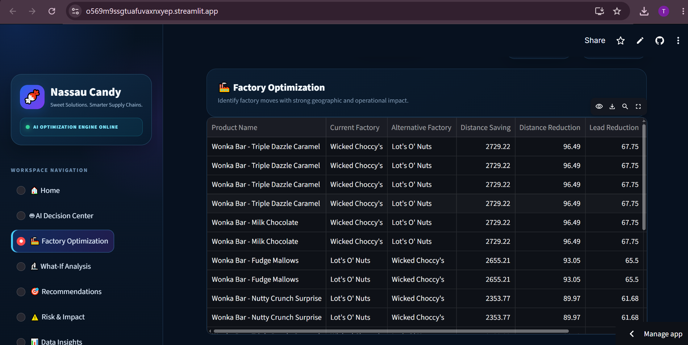
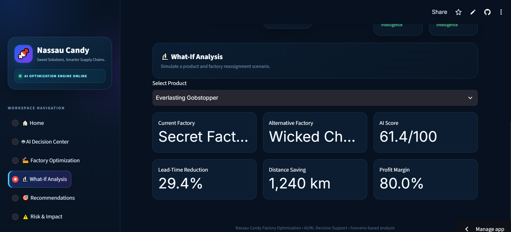
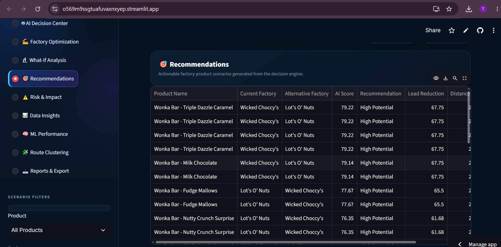
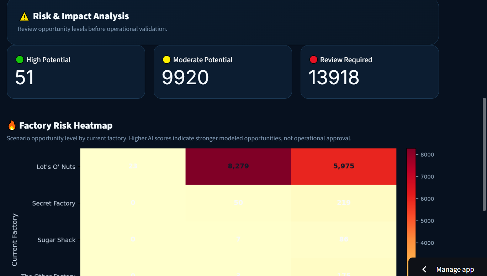

# Factory Reallocation & Shipping Optimization Recommendation System

## Project Overview

This project develops a data-driven Factory Reallocation and Shipping Optimization Recommendation System for Nassau Candy Distributor.

The system analyzes product, factory, destination, shipping mode, geographical distance, scenario-based lead time, and profitability indicators to identify potential factory reallocation opportunities.

It combines data analysis, machine learning, route clustering, scenario simulation, and recommendation scoring to support logistics and operational decision-making.

## Objectives

- Analyze product and shipping data.
- Calculate factory-to-destination geographical distances.
- Identify potential distance savings through factory reassignment.
- Simulate alternative factory assignments.
- Estimate scenario-based shipping lead times.
- Evaluate potential lead-time reductions.
- Identify high-distance and slow scenario-based routes.
- Generate factory reallocation recommendations.
- Build an interactive Streamlit dashboard.

## Dataset

The project uses order-level data containing information such as:

- Order ID
- Order Date and Ship Date
- Ship Mode
- Customer ID
- Country/Region
- City and State/Province
- Product ID and Product Name
- Sales
- Units
- Gross Profit
- Cost

**Note:** Ensure the source dataset is permitted for public sharing before uploading it to GitHub.

## Technologies Used

- Python
- Pandas
- NumPy
- Matplotlib
- Seaborn
- Scikit-learn
- OpenPyXL
- Streamlit
- Jupyter Notebook
- GitHub

## Methodology

### 1. Data Preparation

The dataset was cleaned, validated, and transformed for analysis.

### 2. Factory Mapping

Products were mapped to their respective origin factories.

### 3. Distance Analysis

Factory and destination coordinates were used to calculate geographical distance using the Haversine formula.

### 4. Factory Reallocation Analysis

Alternative factories were evaluated to identify scenarios with potential distance savings.

### 5. Lead-Time Scenario Modeling

Scenario-based lead time was estimated using geographical distance and shipping-mode assumptions.

### 6. Machine Learning

Three regression models were evaluated:

- Linear Regression
- Random Forest Regressor
- Gradient Boosting Regressor

The models were evaluated using RMSE, MAE, and R².

### 7. Route Clustering

K-Means clustering was used to group routes based on distance, lead time, lead-time savings, distance reduction, and profit margin.

### 8. Recommendation Engine

Recommendation scores were calculated using selected factors:

- Lead-Time Reduction
- Distance Reduction
- Profit Margin
- Scenario Confidence

The resulting scenarios were classified into recommendation levels.

## Machine Learning Model Comparison

| Model | RMSE | MAE | R² |
|---|---:|---:|---:|
| Linear Regression | 1.8041 | 1.5402 | 0.6068 |
| Random Forest Regressor | 0.6685 | 0.4899 | 0.9460 |
| Gradient Boosting Regressor | 0.8682 | 0.6853 | 0.9089 |

Random Forest achieved the lowest RMSE and MAE and the highest R² among the three evaluated models.

**Important:** These metrics measure model performance against a scenario-generated lead-time target. They do not establish accuracy against verified real-world shipping times.

## Interactive Dashboard

The project includes a Streamlit dashboard with the following sections:

1. Factory Optimization
2. What-If Analysis
3. Recommendations
4. Risk & Impact

Users can explore scenarios using filters such as:

- Product
- Region
- Ship Mode
- Current Factory
- Alternative Factory
- Speed Priority

**Live Dashboard:**  
[Open Nassau Candy Factory Optimization Dashboard](https://o569m9ssgtuafuvaxnxyep.streamlit.app/)

## Project Outputs

The repository includes analysis and recommendation outputs such as:

- Factory reallocation recommendations
- Product-level recommendations
- Route cluster analysis
- KPI summary
- Machine learning model comparison
- Dashboard recommendation data

## Repository Files

| File | Description |
|---|---|
| `app.py` | Streamlit dashboard application |
| `requirements.txt` | Python dependencies |
| `ml_model_comparison.csv` | Machine learning evaluation results |
| `final_factory_recommendations.csv` | Factory recommendation output |
| `dashboard_recommendations.csv` | Dashboard recommendation data |
| `product_recommendations.csv` | Product-level recommendations |
| `project_kpi_summary.csv` | Project KPI summary |
| `route_cluster_analysis.csv` | Route clustering output |

## How to Run Locally

### Step 1: Clone the repository

```bash
git clone https://github.com/shaikhsano1708/Nassau-Candy-Factory-Optimization.git
```

### Step 2: Open the project folder

```bash
cd Nassau-Candy-Factory-Optimization
```

### Step 3: Install dependencies

```bash
py -m pip install -r requirements.txt
```

### Step 4: Run the Streamlit dashboard

```bash
py -m streamlit run app.py
```

The dashboard should open in your default browser.
## Dashboard Screenshots

### 1. Factory Optimization


### 2. What-If Analysis


### 3. Recommendations


### 4. Risk & Impact


**Prerequisite:** Python must be installed. The source Excel dataset must also be available locally if the application reads it directly.

## Limitations

- Lead-time estimates are based on scenario assumptions.
- Recommendations represent potential opportunities, not confirmed operational savings.
- Actual shipping performance, factory capacity, production costs, and shipping rates should be validated before implementing recommendations.
- Recommendation scores use selected policy weights and should not be interpreted as machine-learning feature importance.
- Model metrics should be interpreted in the context of the generated target.

## Future Improvements

- Validate lead-time predictions against reliable historical transit-time data.
- Incorporate actual factory capacity, production costs, and shipping rates.
- Improve location and route data quality.
- Add automated scenario comparisons and downloadable reports.
- Evaluate recommendations using real operational outcomes.

## Author

**Shaikh Saniya Afsar**

**Organization:** Unified Mentor  
**Project Type:** Internship Project Report

## Project Links

- [GitHub Repository](https://github.com/shaikhsano1708/Nassau-Candy-Factory-Optimization)
- [Live Streamlit Dashboard](https://o569m9ssgtuafuvaxnxyep.streamlit.app/)
## Research Paper

[Download the Nassau Candy Factory Optimization Research Paper (PDF)](Nassau_Candy_Research_Paper_Corrected.pdf)
